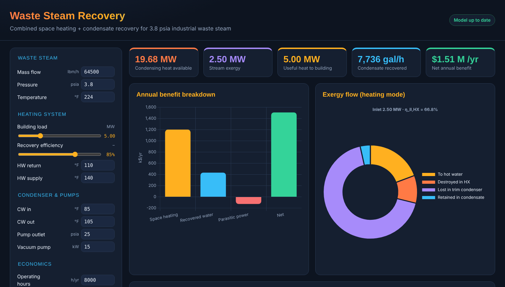
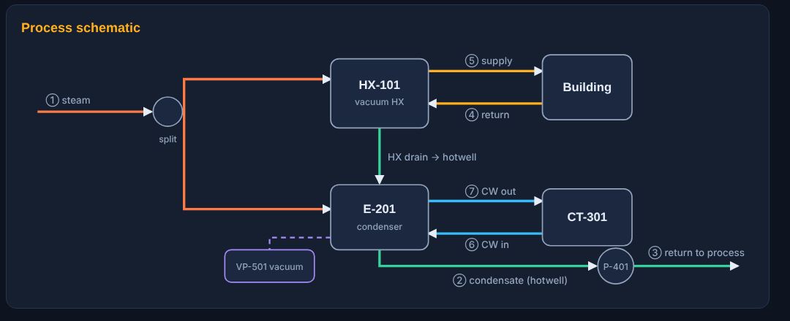

# Waste Steam Recovery: Thermal Design Dashboard


An engineering model and web dashboard for recovering value from **64,500 lbm/h of sub-atmospheric
industrial waste steam (3.8 psia, 224 °F)** through **combined space heating and condensate recovery**.

Built as an extension of a Thermodynamics II (MEEN 3110) design project at the University of North Texas.



---

## Key results (default case)

| Metric | Value |
|---|---|
| Saturation temperature at 3.8 psia | 150.8 °F (steam is superheated by about 73 °F) |
| Heat released by condensing the stream | **19.7 MW** |
| Physical exergy of the stream (T₀ = 77 °F) | **2.50 MW**, only about 12% of the stream energy |
| Useful heat delivered (5 MW building load) | 5.0 MW × 3,000 h/yr |
| Condensate recovered | 7,736 gal/h × 8,000 h/yr |
| Second-law efficiency of the heat exchanger | 66.8% |
| **Net annual benefit** (after parasitic power) | **≈ $1.5 M/yr** |

**Engineering takeaway:** the stream carries a lot of energy but little exergy. It suits low-temperature
heating (about 140 °F hot water) and water recovery better than power generation. The building heat load,
not the steam supply, limits the value of the system.

---

## Features

- **Property-accurate thermodynamics:** CoolProp (IAPWS-95) state points for steam, condensate, the hot-water loop and the cooling-water loop
- **First- and second-law analysis:** mass/energy balances, a component exergy breakdown, and a check that the exergy balance closes
- **Two operating modes:** heating season (3,000 h) and cooling-tower season (5,000 h), with no double counting of benefits
- **Preliminary equipment sizing:** LMTD and UA for the HX and condenser, pump power, cooling-water flow, vacuum system
- **Economics:** heating value, water value and parasitic electricity, giving the net annual benefit
- **Sensitivity analysis:** net benefit vs building load for several recovery efficiencies
- **Feasibility warnings:** flags temperature approaches that cannot work and cases where the steam supply limits heating
- **Tested:** 15 pytest tests (physics checks and API tests), with GitHub Actions CI

## System concept



| Tag | Equipment | Role |
|---|---|---|
| HX-101 | Vacuum steam-to-water heat exchanger | Condenses steam at 3.8 psia; heats the building loop from 110 to 140 °F |
| E-201 | Surface condenser | Condenses all remaining steam; sized for 100% of the flow |
| CT-301 | Cooling tower | Rejects condenser heat outside the heating season |
| P-401 | Condensate pump | Lifts condensate from the vacuum hotwell to 25 psia (low NPSH) |
| P-402 | Hot-water pump | Circulates the building loop |
| VP-501 | Vacuum pump / ejector | Removes non-condensable gases and holds the vacuum |

## Governing equations

```
Q_steam    = m_s (h1 − h2)                          condensing duty
Q_useful   = η_rec · Q_HX  ≤  building load          delivered heat
m_hw       = Q_HX / (h5 − h4)                        hot-water flow
W_pump     = m_s v2 (P3 − P2) / η_p                  condensate pump
ψ          = (h − h0) − T0 (s − s0)                  flow exergy
X_dest,HX  = T0 [ m_HX (s2 − s1) + m_hw (s5 − s4) ]  exergy destruction
η_II,HX    = m_hw (ψ5 − ψ4) / [ m_HX (ψ1 − ψ2) ]
Net $/yr   = Q_useful·H_heat·c_heat + V_water·c_water − W_parasitic·H_op·c_elec
```

## Quick start

```bash
git clone https://github.com/<your-username>/waste-steam-recovery.git
cd waste-steam-recovery
python -m venv .venv && source .venv/bin/activate   # Windows: .venv\Scripts\activate
pip install -r requirements.txt

# Run the web app → http://localhost:8000
uvicorn steamrec.api:app --app-dir backend --reload

# Or use the command line
cd backend && python -m steamrec.cli --load 5 --eff 0.85

# Run tests
pytest -v
```

Docker:

```bash
docker build -t steamrec . && docker run -p 8000:8000 steamrec
```

## API

| Method | Endpoint | Description |
|---|---|---|
| GET | `/api/health` | Service status |
| GET | `/api/defaults` | Default project inputs |
| POST | `/api/analyze` | Full analysis + sensitivity (any input can be overridden) |
| GET | `/docs` | Interactive Swagger documentation |

```bash
curl -X POST localhost:8000/api/analyze -H "Content-Type: application/json" \
     -d '{"building_load_MW": 8, "recovery_efficiency": 0.9}'
```

## Project structure

```
waste-steam-recovery/
├── backend/
│   ├── steamrec/
│   │   ├── units.py        # US ↔ SI conversions
│   │   ├── properties.py   # CoolProp state points, flow exergy
│   │   ├── system.py       # balances, exergy, sizing, economics, sensitivity
│   │   ├── api.py          # FastAPI app (+ serves frontend)
│   │   └── cli.py          # command-line summary
│   └── tests/              # pytest physics + API tests
├── frontend/               # HTML/CSS/JS dashboard (Chart.js)
├── docs/                   # screenshots
├── .github/workflows/ci.yml
├── Dockerfile
└── requirements.txt
```

## Assumptions

- Steady flow; changes in kinetic and potential energy are neglected
- Property source: CoolProp (IAPWS-95); dead state 77 °F and 14.696 psia
- Condensate leaves the HX and condenser as saturated liquid at 3.8 psia; pressure drops are neglected
- Recovery efficiency = the fraction of HX duty that reaches the building as useful heat
- Plant operates 8,000 h/yr; heating is credited only during the 3,000 heating hours
- Recovered water is valued at standard density (60 °F) at $0.70 per 100 gal
- Cooling-tower fan and pump parasitic load is 10 kW per MW rejected; vacuum pump 15 kW
- Equipment cost and payback are outside the project scope

## Limitations and future work

- Add equipment cost correlations and payback / NPV
- Model the heating load hour by hour (degree days) instead of a constant average load
- Compare against power recovery (ORC or a vacuum steam turbine) and a heat pump that upgrades the heat temperature
- Detailed HX design (ε-NTU, tube counts) and vacuum-pump sizing based on air leakage

## Tech stack

Python · CoolProp · FastAPI · Pydantic · pytest · JavaScript · Chart.js · GitHub Actions · Docker

## Author

**Ashish**, Mechanical Engineering, University of North Texas
[LinkedIn](https://linkedin.com/in/<your-profile>) · open to thermal / energy / HVAC internships

## License

MIT
